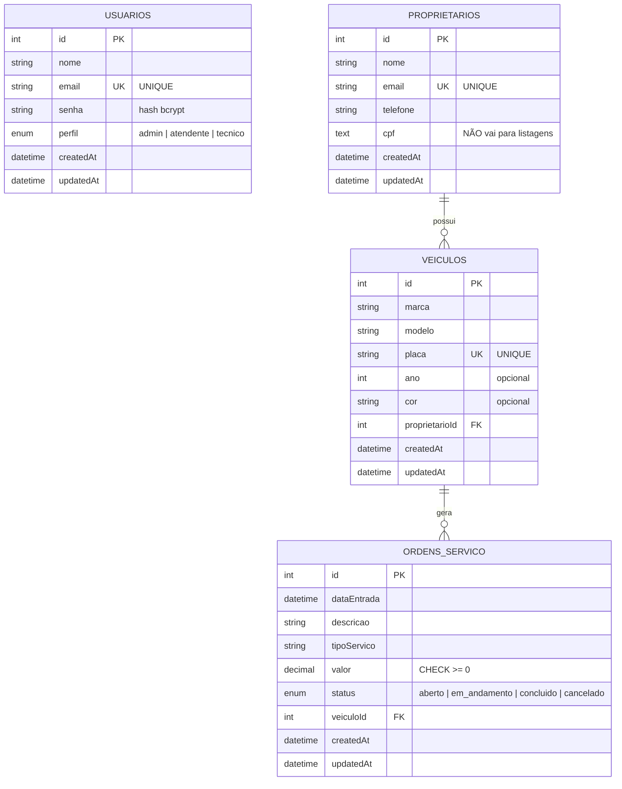

# DER — Gestão Automotiva

**DER** = Diagrama Entidade-Relacionamento: desenho das tabelas (entidades), campos principais e como elas se ligam.

Este diagrama espelha o banco implementado pelas migrations em `backend/src/migrations/` (fonte de verdade do projeto). O script didático equivalente está em `docs/schema_referencia.sql`.

## Relacionamentos (1:N)

| De | Para | Cardinalidade | FK |
|----|------|---------------|----|
| `proprietarios` | `veiculos` | 1 : N | `veiculos.proprietarioId` |
| `veiculos` | `ordens_servico` | 1 : N | `ordens_servico.veiculoId` |

- Um proprietário pode ter **vários** veículos.
- Um veículo pode ter **várias** ordens de serviço.
- `usuarios` é entidade de autenticação interna (login); **não** tem FK para as outras tabelas neste modelo.

## Regras importantes para apresentar

- **UNIQUE:** `usuarios.email`, `proprietarios.email`, `veiculos.placa`
- **CPF:** existe na tabela `proprietarios`, mas **não deve aparecer nas listagens** da API/UI (dado sensível — RF10)
- **ENUM:** `usuarios.perfil` (`admin` \| `atendente` \| `tecnico`); `ordens_servico.status` (`aberto` \| `em_andamento` \| `concluido` \| `cancelado`)
- **CHECK:** `ordens_servico.valor >= 0`
- **ON DELETE RESTRICT** nas FKs: não apaga proprietário/veículo se ainda houver registros filhos

## Diagrama (Mermaid)

### Como ler os símbolos

- `PK` = chave primária (`id`)
- `FK` = chave estrangeira (liga a outra tabela)
- `UK` = UNIQUE (não pode repetir)
- `||--o{` = **um** do lado esquerdo para **muitos** do lado direito (1:N)

## Onde visualizar

- No GitHub/GitLab o Mermaid costuma renderizar sozinho no Markdown.
- No VS Code / Cursor: extensão de preview Markdown com Mermaid, ou abrir o preview do arquivo.
- Alternativa de entrega: exportar o diagrama como imagem/PDF a partir do preview, se a banca pedir arquivo visual separado.
